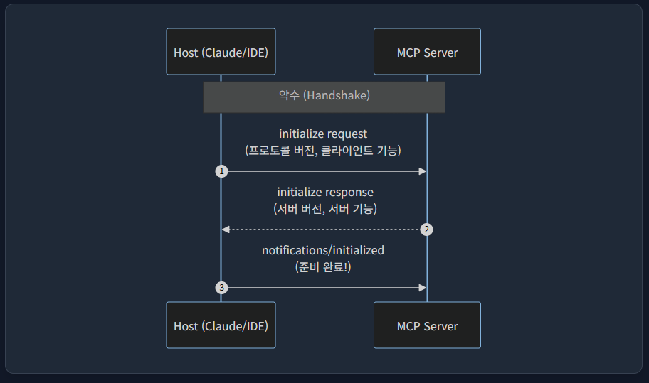
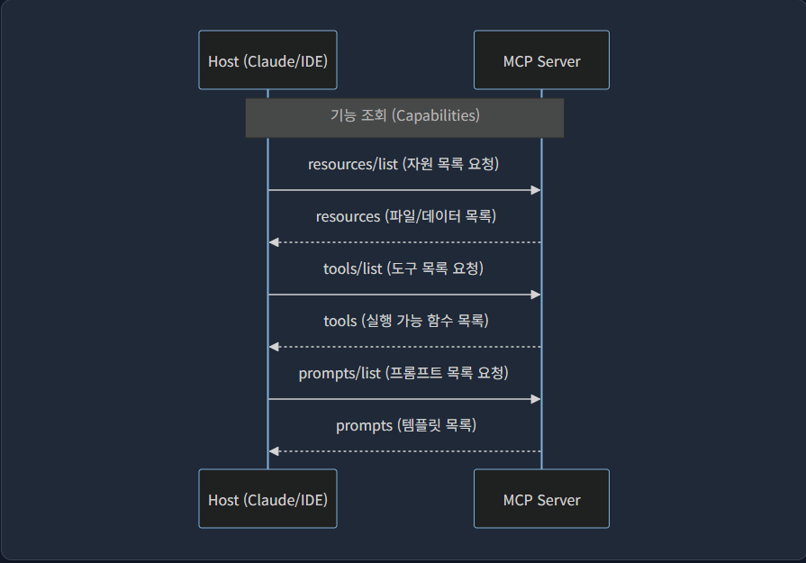
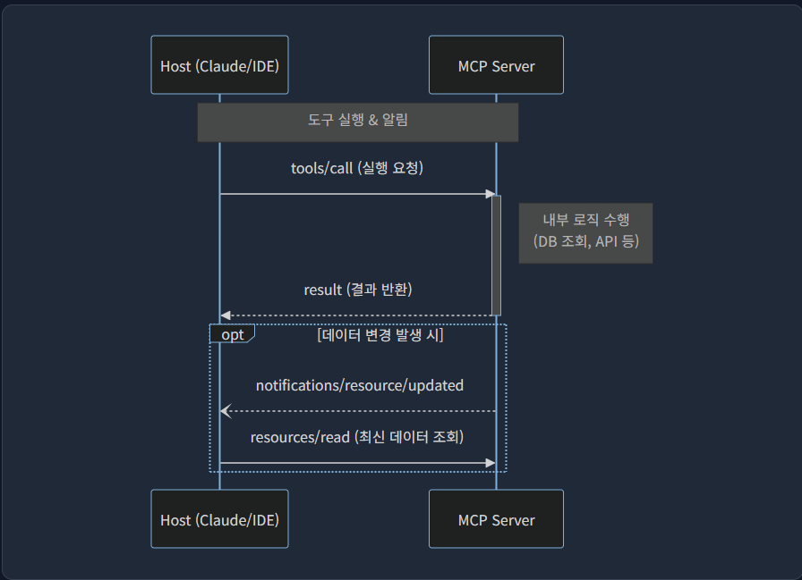
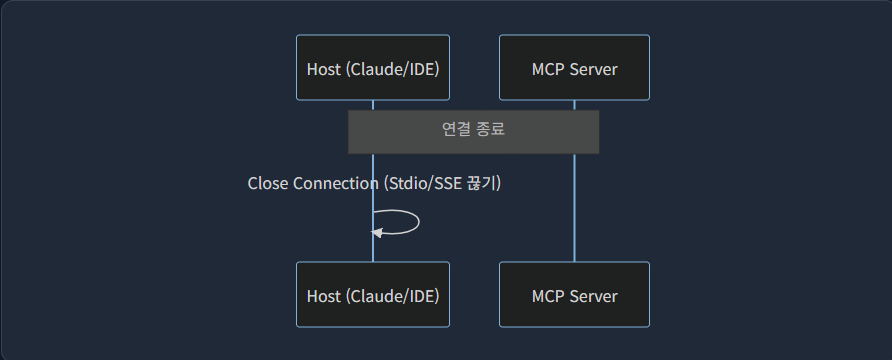

# MCP 란?
MCP(Model Context Protocol)은 AI 애플리케이션을 외부 시스템에 연결하기 위한 오픈 소스 표준

MCP를 사용하면 Claude, ChatGPT 와 같은 AI 애플리케이션은 데이터소스, 도구, 등에 연결 가능

MCP는 AI 애플리케이션을 외부 시스템에 연결하는 표준화된 방식을 제공


## MCP 아키텍처

### MCP HOST
Cursor, Claude Desktop, antigravity, IDE, 등 설치형 앱으로 LLM API로 통신

### MCP CLIENT
MCP HOST에 구현되어 있는 기능(?) MCP서버와 MCP HOST와의 통신 역할을 담당함

### MCP SERVER
우리가 MCP를 구현한다고 하면 보통 MCP SERVER임, HOST에게 어떤 상황에서 어떤 도구를 사용하라고 정의한 공구함
초기 MCP HOST와 MCP SERVER를 연결하는 과정에서 도구들을 받고, 이후 사용자 질의에 따라 LLM이 사용할 도구를 선택하여 실행함
개발자들인 이 도구를 정의하여 어떤 내용을 컨텍스트에 포함하여 LLM에게 제공하여 사용자에게 보다 정확한 답변을 하게 함

## MCP 레이어
MCP는 두 개의 계층이 존재
* 데이터 계층: 클라이언트 - 서버 통신을 위한 JSON-RPC 기반 프로토콜을 정의, 라이프사이클 관리 및 도구, 리소스, 프롬프트, 알림 같은 요소
* 전송 계층: 클라이언트와 서버간의 데이터 교환을 가능하게 하는 통신 메커니즘 및 채널을 정의

### 데이터 계층
JSON-RPC 2.0 기반 교환 프로토콜을 구현하며 아래와 같음
* 라이프사이클 관리: 클라이언트 - 서버 연결 초기화, 기능 및 연결 종료 처리
* 서버 기능: 서버 AI 액션도구, 컨텍스트 데이터 리소스, 클라이언트와의 상호 작용 템플릿 프롬프트 등 핵심 기능 제공
* 클라이언트 기능: 샘플링, 사용자 입력, 클라이언트 메시지 기록 등 
* 유틸리티 기능: 실시간 업데이트 알림 및 장기 실행 작업의 진행 상황 추적 같은 기능

> 직접 구현하면 귀찮으니까 SDK를 사용하자.
>

| SDK 함수              | 하는일      | 역할     |
|---------------------|----------|--------|
| new MCPServer(...)  | 클라이언트가 접속하면 자동으로 initialize 요청을 받고, "나 준비됐어!" 하고 initialized 응답을 보냄.  | 연결     |
| server.tool(...)    | 클라이언트가 tools/list라고 물어보면, 내가 등록한 함수들을 리스트로 쫙 뽑아서 JSON으로 던져줌.| 기능명세서  |
| server.resouce(...) | 클라이언트가 resources/read라고 요청하면, 해당 데이터를 찾아서 리턴해줌.  | 데이터 제공 |
| server.prompt(...) | 클라이언트가 prompts/get이라고 하면 미리 짜둔 템플릿을 줌.  | 지시서 제공 |
| server.connect(...) | Stdio나 SSE 같은 운송 수단(Transport)에 JSON-RPC 메시지를 태워서 보냄.  | 배송     |

### MCP 전송 계층(Transport Layer)
mcp의 전송계층은 stdio 방식과  Streamable HTTP 이 존재함

#### STDIO 방식에 대한 설명
* 로컬에서 실행
* 로컬에서 실행하므로 클라인트는 오직 나 하나
* 개인 전속 요리사를 고용한것이라고 생각하면 됨

#### STDIO 방식을 선택할 때
* 파일 시스템 조작이 필요할 때 사용
* 보안이 중요할 때
* 설정 및 토큰이 필요 없을 때


#### Streamable HTTP 방식
* 별도의 웹서버에서 실행
* 클라이언트는 N개임
* 일반 식당에서 주문하는 것처럼 손님들이 다양함

#### Streamable HTTP 를 선택할 때
* 무거운 연산이 필요한 경우(서버 장비가 좋아야 함)
* 중앙 통제가 필요 할 때
* 별도의 설치 프로세스를 하기 싫을 때

## MCP 서버 기본 3가지 요소

### 프롬프트: 작업 지시서
  * 미리 정의된 양식을 사용하여 LLM에게 전달
  * MCP Prompt는 사용자가 지시를 할 때만 적용됨
  * 리소스를 미리 임베딩 가능
### 리소스: 메뉴판 & 레시피(데이터)
  * 미리 프롬프트나 사용자 질의에 해당 리소스를 사용하라고 명시 후 툴즈 처리
  * 툴즈로만 실행해도 됨
  * 리소스를 사용 했을 때, 장점은 작은 데이터를 가져올 때, 미리 컨텍스트에 담기기 때문에 따로 tools 호출을 막음? 장점 맞나?
  * 단점: 데이터가 너무 크거나, 실시간 데이터면 리소스보다는 툴이 유리
### Tools: 조리 도구 
  * 사용자 질의에 따른 LLM이 사용할 도구를 선택하여 처리
  * 매개변수를 사용 가능함(리소스와 차이)
  * 리소스는 읽기, 툴즈는 CRUD 가능함

## MCP서버에서 MCP 클라이언트에 요구하는 3가지
MCP 서버에서 MCP 클라이언트에게 요청 할 수 있다
### 샘플링
서버는 단순히 코드를 실행하는 역할만 담당함, 서버가 작업 중 요약, 직문, 추론이 필요한 경우 클라이언트(LLM)에게 역으로 요청
`sampling/createMessage`에 요청을 보내서 사용한다.

```javascript
server.registerTool('create_gitlab_mr', {}, async () => {
  await server.server.request({
    method: 'sampling/createMessage',
    params: {
      maxTokens: 100,
      messages: [
        {
          role: "user",
          content: {
            type: "text",
            text: `Commit Message for: `
          }
        }
      ]
    }
  }, CreateMessageResultSchema)
})
```

```javascript
server.registerTool('create_gitlab_mr', {}, async () => {
  await server.server.createMessage({
    tools: [],
    maxTokens: 100,
    messages: [
      {
        role: 'user',
        content: {
          type: 'text',
          text: `Commit Message for: `
        }
      }
    ],

  })
})
```
> sampling에서 tools를 요청하면 LLM이 어떤 tools를 사용할지 판단하고, 개발자는 샘플링 응답데이터로 해당 tools를 직접 실행해야 한다.

### 정보 요청(Elicitation)

서버가 작업을 진행하기 전에 User의 응답을 기다리게 가능 `elicitation/requestInput`로 요청을 보냄(아래 예시는 한번에 모든 응답을 요구함(통신 낭비를 줄이기 위함))
```javascript
server.registerTool('create_gitlab_mr', {}, async () => {
  await server.server.request({
    method: 'elicitation/requestInput',
    params: {
      message:"질문에 응답해주세요.",
      schema: {
        type: "object",
        properties: {
          confirmWork: {
            type: "boolean",
            description: "커밋 & 푸시를 하시겠습니까?"
          },
          requestMessage: {
            type: "string",
            description: "커밋메시지를 입력해주세요"
          },
        },
        required: ["confirmWork"]
      }
    }
  }, CreateMessageResultSchema)
  })
```

```javascript
await server.server.elicitInput({
  message: '사용자야 대답해줘.',
  requestedSchema: {
    type:'object',
    properties: {
      confirmWork: {
        type: "boolean",
        description: "커밋 & 푸시를 하시겠습니까?"
      },
      requestMessage: {
        type: "string",
        description: "커밋메시지를 입력해주세요"
      },
    },
    required:['confirmWork']
  }
})
```
### Root
서버가 파일 시스템이나 환경에 접근하기 전에 **어디까지 접근 가능한 작업 가능해요?**라고 물어보기 위한 기능. (권한을 달라고 하는 요청이 아님.)
```javascript
server.server.listRoots()
```

### 로깅
* 서버가 사용자 화면에 로그나 에러 메시지를 띄움

### 알림
서버와 클라이언트 간의 동적 업데이트가 가능하게 해주는 실시간 알림?

```javascript
server.server.notification()
```

## MCP 라이프사이클
MCP 라이프사이클은 연결, 초기화,탐색, 실행, 종료 단계가 있음
### 1.연결
STDIO 방식에서는 Node로 mcp 서버를 실행하고 HTTP 방식에서는 Reqeust로 요청

### 2. 초기화 단계


* 클라이언트 to 서버
```json
{
  "jsonrpc": "2.0",
  "id": 1,
  "method": "initialize",
  "params": {
    "protocolVersion": "2025-06-18",
    "capabilities": {
      "elicitation": {} // elicitation 기능을 제공
    },
    "clientInfo": {
      "name": "example-client",
      "version": "1.0.0"
    }
  }
}
```
* 서버 to 클라이언트
```json
{
  "jsonrpc": "2.0",
  "id": 1,
  "result": {
    "protocolVersion": "2025-06-18",
    "capabilities": {
      "tools": {
        "listChanged": true
      },
      "resources": {}
    },
    "serverInfo": {
      "name": "example-server",
      "version": "1.0.0"
    }
  }
}
```
위와 같이 프로토콜 버전과 클라이언트 정보, **capabilities(어떤기능을 제공하는지) **를 서로 교환하여 초기화 단계를 거침,
초기화가 완료되면 알림을 보냄.
* 알림
```json
// Client -> Server (Notification은 id가 없음)
{
  "jsonrpc": "2.0",
  "method": "notifications/initialized"
}

```

> 프로토콜 버전은 MCP 표준 위언회에서 관리함(오픈소스 커뮤니티)

### 3. 기능 요청 단계

```json
{
  "jsonrpc": "2.0",
  "id": 2,
  "method": "tools/list"
}
```

```json
{
  "jsonrpc": "2.0",
  "id": 2,
  "result": {
    "tools": [
      {
        "name": "calculator_arithmetic",
        "title": "Calculator",
        "description": "Perform mathematical calculations including basic arithmetic, trigonometric functions, and algebraic operations",
        "inputSchema": {
          "type": "object",
          "properties": {
            "expression": {
              "type": "string",
              "description": "Mathematical expression to evaluate (e.g., '2 + 3 * 4', 'sin(30)', 'sqrt(16)')"
            }
          },
          "required": ["expression"]
        }
      }
    ]
  }
}
```

클라이언트가 서버에 `tools/list`, `resources/list`, `prompts/list`로 요청하면 서버가 클라이언트에 내려 줌
* `name`: LLM이 사용할 고유 식별자 ID
* `title`: 사람이 읽기 쉽게하는 타이틀
* `description`: LLM이 읽고 어떤 상황에서 이 도구를 써야하는지 판단하는 근거
* `inputSchema`: 입력 매개변수를 정의하는 JSON 스키마

> 위 내용은 tools 에 관한 내용임 resources, prompts 에 관한 스펙은 따로 찾아보시오
### 4. 실행 단계

### 5. 종료 단계

